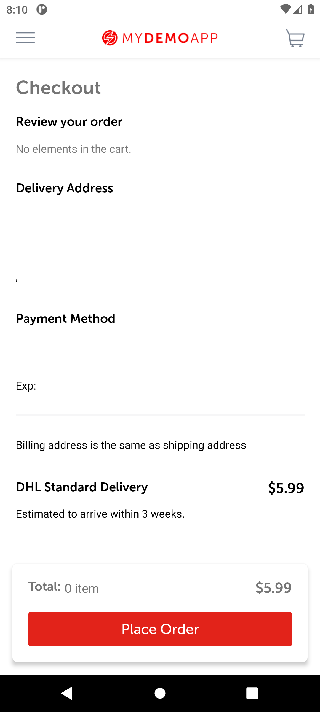
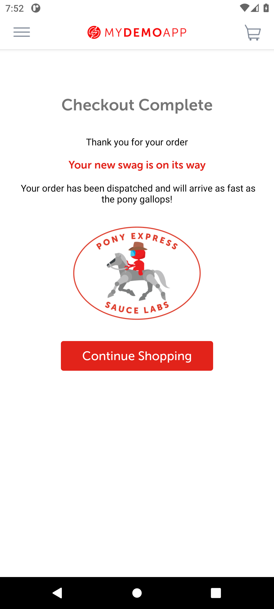

# BUG-001: Back from the order confirmation opens a review screen that lets an empty order be placed

| Field | Value |
|---|---|
| Severity | Critical |
| Priority | High |
| Module | Checkout |
| Status | Open |
| Found in | My Demo App 1.3.0 (build 244), Android 11 emulator (API 30, Pixel 6 profile, 1080 x 2400) |
| Failed test case | TC-032 |

## Steps to reproduce
1. Add any product to the cart and complete checkout (log in as bob@example.com / 10203040, any valid address, card 4111 1111 1111 1111, 12/30, 123)
2. On the "Checkout Complete" screen press the Android Back button
3. On the screen that opens, tap Place Order

## Expected result
The catalog (or the confirmation screen again). There must be no way back into checkout with an empty cart, and no order can be placed without items.

## Actual result
After Back, a "Review your order" screen opens: "No elements in the cart.", an empty delivery address and card, "DHL Standard Delivery $5.99", "Total: 0 item $5.99" and a red Place Order button that is active. Tapping Place Order shows "Checkout Complete: Thank you for your order. Your new swag is on its way" (second screenshot).

## Evidence

> Impact if real: An order with no items and no address is accepted and confirmed to the customer, with shipping as the only charge. A double tap on Back is enough to get there. Such orders would reach fulfilment and support.
>
> The app is a public demo, so this is reported as it would be on a real product; the demo has no real customers or payments.
