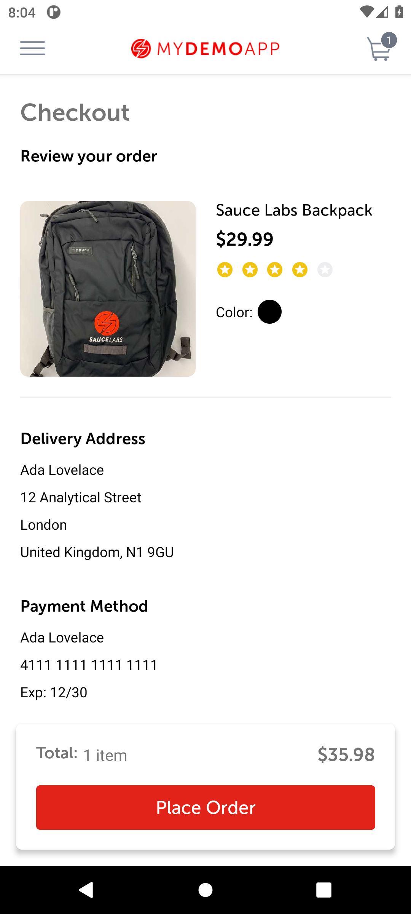

# BUG-002: The review screen shows the full card number

| Field | Value |
|---|---|
| Severity | Major |
| Priority | High |
| Module | Checkout |
| Status | Open |
| Found in | My Demo App 1.3.0 (build 244), Android 11 emulator (API 30, Pixel 6 profile, 1080 x 2400) |
| Failed test case | TC-028 |

## Steps to reproduce
1. Add a product; start checkout and log in
2. Enter an address; on the payment step enter card 4111 1111 1111 1111, expiry 12/30, code 123
3. Tap Review Order

## Expected result
Only the last four digits of the card, for example "•••• 1111". The expiry is also usually hidden.

## Actual result
The Payment Method block shows "4111 1111 1111 1111" and "Exp: 12/30" in full.

## Evidence

> Impact if real: A card number on screen can be read by someone nearby and appears in screenshots, screen recordings and support tickets. Card standards (PCI DSS) expect it to be masked when displayed.
>
> The app is a public demo, so this is reported as it would be on a real product; the demo has no real customers or payments.
