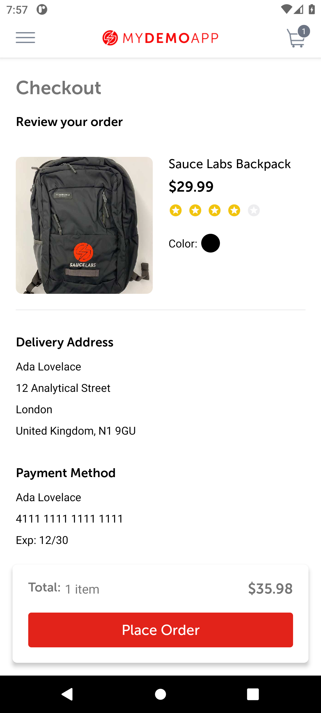
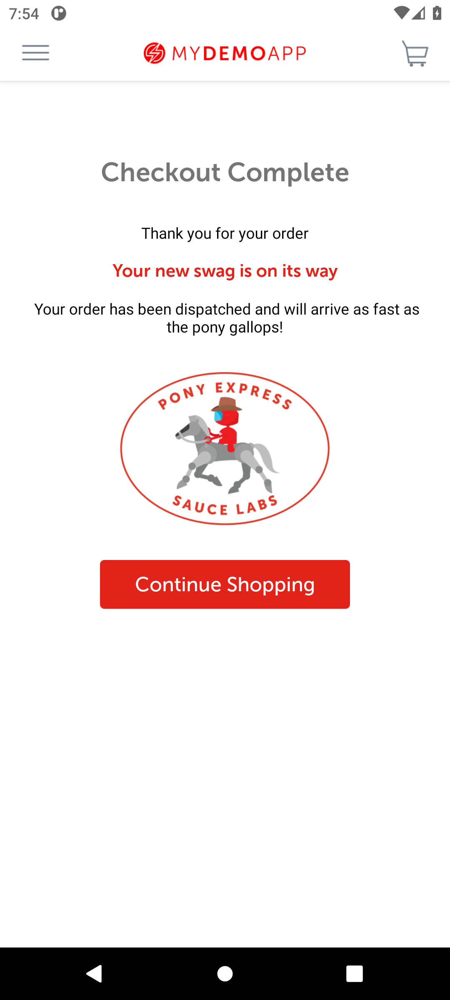

# BUG-003: A 1-digit security code is accepted

| Field | Value |
|---|---|
| Severity | Major |
| Priority | Medium |
| Module | Checkout |
| Status | Open |
| Found in | My Demo App 1.3.0 (build 244), Android 11 emulator (API 30, Pixel 6 profile, 1080 x 2400) |
| Failed test case | TC-027 |

## Steps to reproduce
1. Start checkout and reach the payment step
2. Card 4111 1111 1111 1111, expiry 12/30, security code "1"
3. Tap Review Order, then Place Order

## Expected result
Refused with a message: the security code has 3 or 4 digits.

## Actual result
The review screen opens, and tapping Place Order shows "Checkout Complete: Thank you for your order" (second screenshot).

## Evidence

> Impact if real: An invalid security code is accepted and the customer is told the order is on its way. In a real shop the payment provider would reject it afterwards, and the customer would learn that late, or not at all.
>
> The app is a public demo, so this is reported as it would be on a real product; the demo has no real customers or payments.
