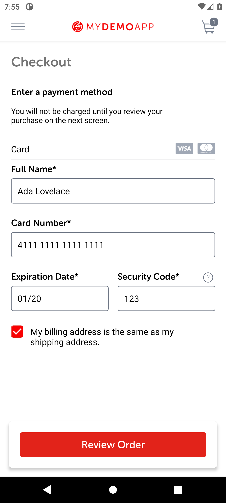

# BUG-004: An expired card is refused without any message

| Field | Value |
|---|---|
| Severity | Major |
| Priority | Medium |
| Module | Checkout |
| Status | Open |
| Found in | My Demo App 1.3.0 (build 244), Android 11 emulator (API 30, Pixel 6 profile, 1080 x 2400) |
| Failed test case | TC-026 |

## Steps to reproduce
1. Start checkout and reach the payment step
2. Card 4111 1111 1111 1111, expiry 01/20, security code 123
3. Tap Review Order

## Expected result
A message next to the expiry date, as the address form gives for empty fields.

## Actual result
Nothing happens: the payment screen stays, no error text appears on the screen or in its accessibility tree.

## Evidence

> Impact if real: The customer does not know why they cannot continue and may abandon the purchase. The address form shows that the app can display field messages, so the gap is inconsistent.
>
> The app is a public demo, so this is reported as it would be on a real product; the demo has no real customers or payments.
