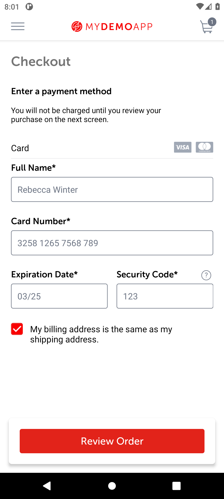

# BUG-006: A full name of only digits is accepted

| Field | Value |
|---|---|
| Severity | Minor |
| Priority | Low |
| Module | Checkout |
| Status | Open |
| Found in | My Demo App 1.3.0 (build 244), Android 11 emulator (API 30, Pixel 6 profile, 1080 x 2400) |
| Failed test case | TC-023 |

## Steps to reproduce
1. Start checkout and reach the address form
2. Full Name "12345"; other fields valid
3. Tap To Payment

## Expected result
An error on the name field.

## Actual result
The payment step opens.

## Evidence

> Impact if real: Wrong names on parcels and invoices.
>
> The app is a public demo, so this is reported as it would be on a real product; the demo has no real customers or payments.
