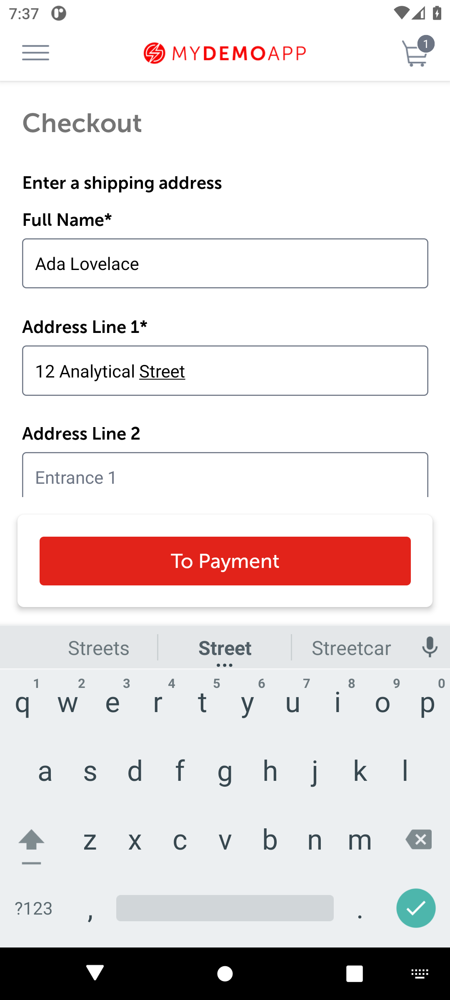

# BUG-007: With the keyboard open, the address form does not scroll to the fields being filled

| Field | Value |
|---|---|
| Severity | Minor |
| Priority | Medium |
| Module | Checkout |
| Status | Open |
| Found in | My Demo App 1.3.0 (build 244), Android 11 emulator (API 30, Pixel 6 profile, 1080 x 2400) |
| Failed test case | TC-024 |

## Steps to reproduce
1. Start checkout and reach the address form on a phone with the on-screen keyboard (Android 11 emulator, Google keyboard)
2. Type into Full Name and then Address Line 1

## Expected result
The form scrolls so that the next field (Address Line 2, City) stays visible above the keyboard.

## Actual result
Only Full Name, Address Line 1 and the top of Address Line 2 are visible; the To Payment panel and the keyboard cover the rest and the form did not scroll. Whether a person can scroll the form by hand with the keyboard open was not tested.

## Evidence

> Impact if real: On small phones filling the form is harder and error-prone; the keyboard must be dismissed to see City, Zip Code and Country.
>
> The app is a public demo, so this is reported as it would be on a real product; the demo has no real customers or payments.
