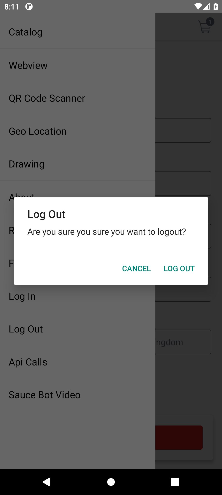

# BUG-008: Log-out confirmation has a repeated word: "Are you sure you sure"

| Field | Value |
|---|---|
| Severity | Cosmetic |
| Priority | Low |
| Module | Menu |
| Status | Open |
| Found in | My Demo App 1.3.0 (build 244), Android 11 emulator (API 30, Pixel 6 profile, 1080 x 2400) |
| Failed test case | TC-019 |

## Steps to reproduce
1. Open the menu
2. Tap Log Out

## Expected result
"Are you sure you want to log out?"

## Actual result
"Are you sure you sure you want to logout?"

## Evidence

> Impact if real: Looks careless; the word "logout" is also a noun where the verb "log out" is meant.
>
> The app is a public demo, so this is reported as it would be on a real product; the demo has no real customers or payments.
